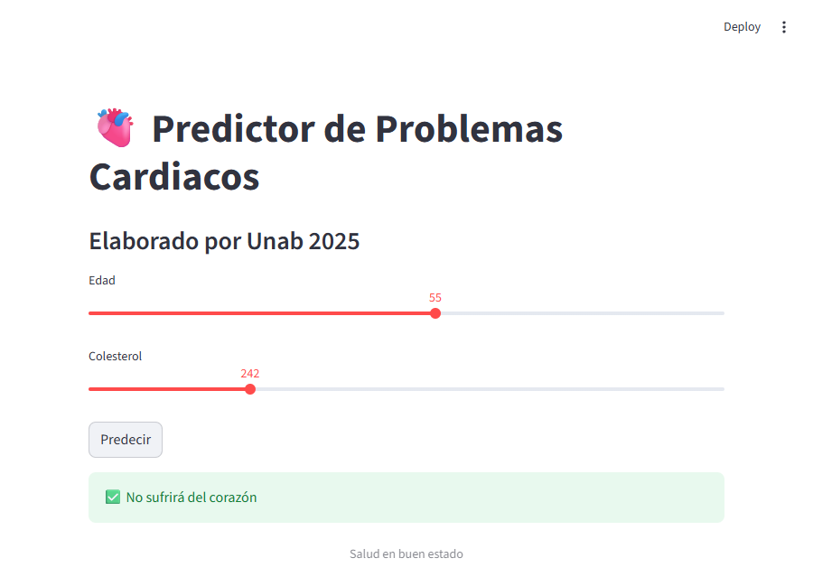
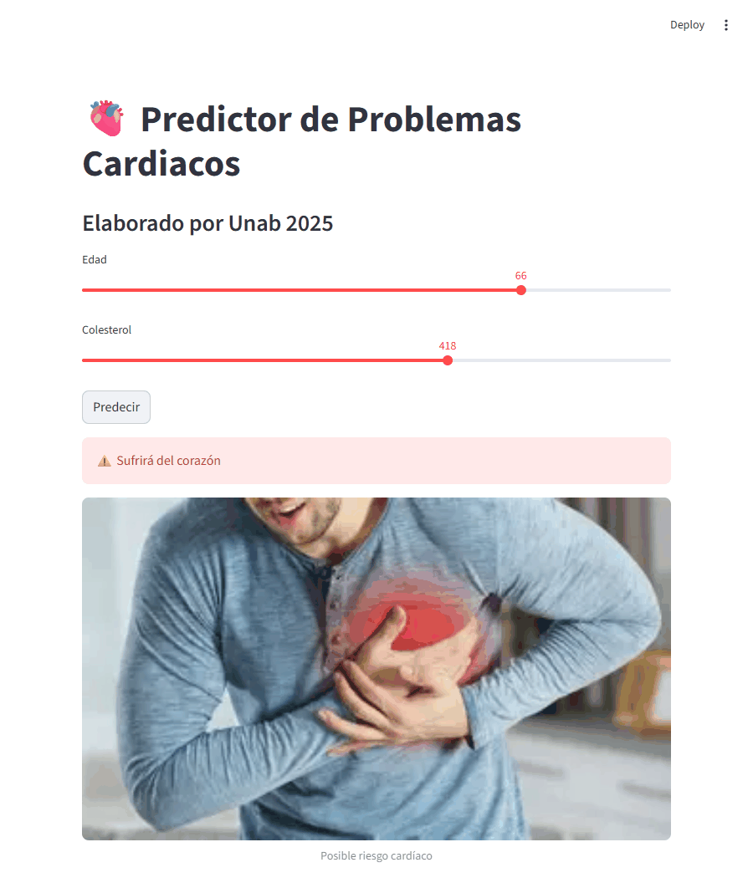
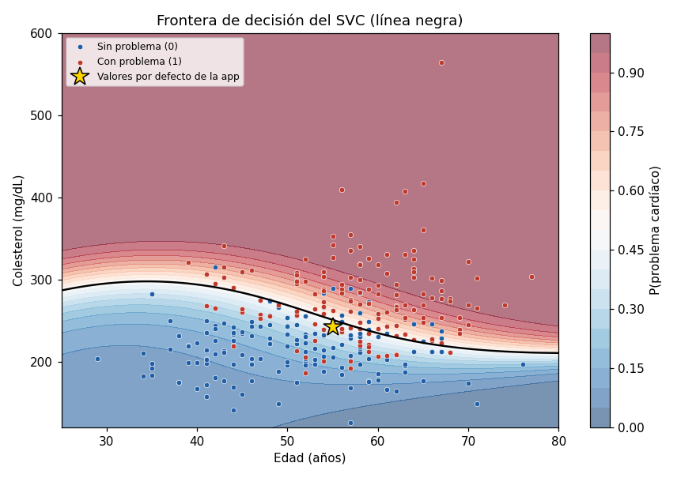

# 🫀 Predictor de Problemas Cardíacos


Aplicación en **Streamlit** que estima si una persona tiene riesgo de sufrir problemas cardíacos a partir de solo dos variables: su **edad** y su nivel de **colesterol**. Por debajo hay un clasificador **SVC** (máquina de vectores de soporte con kernel polinómico) entrenado con datos de pacientes reales, normalizados con **MinMaxScaler**.

| Sin riesgo (edad 55, colesterol 242) | Con riesgo (edad 66, colesterol 418) |
|:---:|:---:|
|  |  |

**Autor:** Daniel Enrique Villamizar Ramírez · Ciencia de Datos · UNAB 2025

---

## Contenido

1. [Cómo funciona](#cómo-funciona)
2. [Estructura del repositorio](#estructura-del-repositorio)
3. [Requisitos](#requisitos)
4. [Ejecutar la aplicación (5 minutos)](#ejecutar-la-aplicación-5-minutos)
5. [Reentrenar el modelo desde cero](#reentrenar-el-modelo-desde-cero)
6. [Datos](#datos)
7. [Resultados del modelo](#resultados-del-modelo)
8. [Problemas frecuentes](#problemas-frecuentes)

---

## Cómo funciona

```text
 Edad, Colesterol ──► MinMaxScaler (scaler.jb) ──► SVC (svc_model.jb) ──► 0 = No sufrirá / 1 = Sufrirá
   (sliders)          escala cada variable a [0, 1]   kernel poly, C = 0.8
```

1. El usuario mueve dos *sliders*:
   - **Edad:** de 25 a 80 años (por defecto 55, paso 1).
   - **Colesterol:** de 120 a 600 mg/dL (por defecto 242, paso 2).
2. Al pulsar **Predecir**, la app normaliza los dos valores con `scaler.jb` y le pide la clase a `svc_model.jb`.
3. Si la predicción es **0** muestra el mensaje verde *"No sufrirá del corazón"*; si es **1**, el aviso rojo *"Sufrirá del corazón"*. Cada caso va acompañado de una imagen ilustrativa.

La frontera que aprendió el modelo (zona roja = riesgo, línea negra = límite de decisión, estrella = valores por defecto de la app):

<p align="center"></p>

El umbral de colesterol a partir del cual el modelo predice riesgo baja con la edad: unos **296 mg/dL a los 30 años**, **252 a los 55** y **212 a los 80**.

## Estructura del repositorio

```text
Corazon/
├── app.py              App de Streamlit (interfaz y predicción)
├── entrenar.py         Entrena el modelo y regenera los archivos .jb
├── pacientes.csv       Datos de entrenamiento (302 pacientes)
├── scaler.jb           MinMaxScaler ajustado (joblib)
├── svc_model.jb        Modelo SVC entrenado (joblib)
├── requirements.txt    Dependencias
└── imagenes/           Capturas y figuras de este README
```

## Requisitos

- **Python 3.10 o superior** (probado con Python 3.13).
- `pip` y, recomendado, un entorno virtual.
- Internet la primera vez para instalar paquetes (la app también descarga de internet las dos imágenes ilustrativas).

## Ejecutar la aplicación (5 minutos)

```bash
# 1. Clonar el repositorio
git clone https://github.com/Daniverd15/Corazon.git
cd Corazon

# 2. Crear y activar un entorno virtual
python -m venv .venv
.venv\Scripts\activate          # Windows
# source .venv/bin/activate     # Linux / macOS

# 3. Instalar dependencias
pip install -r requirements.txt

# 4. Lanzar la app
streamlit run app.py
```

Streamlit abre el navegador en **http://localhost:8501**. Mueve los *sliders* y pulsa **Predecir**.

> **Comprobación rápida:** con los valores por defecto (edad 55, colesterol 242) la app debe responder **"No sufrirá del corazón"**; con edad 66 y colesterol 418, **"Sufrirá del corazón"**.

## Reentrenar el modelo desde cero

`scaler.jb` y `svc_model.jb` ya vienen entrenados, así que este paso es opcional. Para regenerarlos:

```bash
python entrenar.py
```

[`entrenar.py`](entrenar.py) hace lo siguiente:

| Paso | Qué hace |
|---|---|
| 1. Carga | Lee `pacientes.csv` (columnas `edad`, `colesterol`, `problema_cardiaco`). |
| 2. Limpieza | Elimina las 4 filas con valores faltantes → quedan **298 pacientes** (147 con problema, 151 sin problema). |
| 3. División | 80 % entrenamiento / 20 % prueba, estratificado, `random_state=42`. |
| 4. Escalado | `MinMaxScaler` ajustado **solo** con el conjunto de entrenamiento. |
| 5. Modelo | `SVC(kernel="poly", C=0.8, probability=True, random_state=42)`. |
| 6. Evaluación | Imprime exactitud, matriz de confusión y reporte por clase sobre el 20 % de prueba. |
| 7. Guardado | Sobrescribe `scaler.jb` y `svc_model.jb`, que son los que carga `app.py`. |

Salida esperada:

```text
Registros usados: 298  (clase 1: 147, clase 0: 151)

Exactitud en prueba: 0.850
Matriz de confusión (filas = real, columnas = predicho):
[[27  3]
 [ 6 24]]
```

También acepta otro CSV con las mismas columnas: `python entrenar.py ruta/a/otros_datos.csv`.

> **Nota:** el código original con el que se entrenaron los `.jb` incluidos no quedó en el repositorio. `entrenar.py` reconstruye el procedimiento a partir de los parámetros guardados dentro de esos archivos (`MinMaxScaler` y `SVC(kernel="poly", C=0.8, random_state=42)`). El modelo que produce coincide con el incluido en el **99.6 %** de las combinaciones de edad (25–80) y colesterol (120–600).

## Datos

`pacientes.csv` es el conjunto de datos del curso ([fuente original](https://raw.githubusercontent.com/adiacla/bigdata/refs/heads/master/pacientes.csv)):

| Columna | Tipo | Descripción |
|---|---|---|
| `edad` | entero | Edad del paciente en años (29 – 77) |
| `colesterol` | entero | Colesterol sérico en mg/dL (126 – 564) |
| `problema_cardiaco` | 0 / 1 | Variable objetivo: 1 = tiene problema cardíaco |

302 registros, con 2 valores faltantes en `edad` y 2 en `colesterol`; las dos clases están prácticamente balanceadas.

## Resultados del modelo

Sobre el 20 % de prueba (60 pacientes):

| Clase | Precisión | Recall | F1 |
|---|---|---|---|
| Sin problema (0) | 0.82 | 0.90 | 0.86 |
| Con problema (1) | 0.89 | 0.80 | 0.84 |
| **Exactitud global** | | | **0.85** |

Con solo dos variables el modelo acierta 85 de cada 100 casos de prueba. Es un ejercicio académico: **no sirve como herramienta de diagnóstico médico**.

## Problemas frecuentes

| Problema | Solución |
|---|---|
| `streamlit: command not found` | Activa el entorno virtual o usa `python -m streamlit run app.py`. |
| `InconsistentVersionWarning` al cargar los `.jb` | Se guardaron con otra versión de scikit-learn. Instala la de `requirements.txt` o ejecuta `python entrenar.py` para regenerarlos con tu versión. |
| `FileNotFoundError: scaler.jb` | Ejecuta `streamlit run app.py` desde la carpeta del repositorio. |
| No aparecen las imágenes de resultado | Se cargan desde internet; revisa tu conexión. La predicción funciona igual. |

## Tecnologías

Python · pandas · NumPy · scikit-learn (`MinMaxScaler`, `SVC`) · joblib · Streamlit

---

<p align="center"><sub>Proyecto académico · Ciencia de Datos · Universidad Autónoma de Bucaramanga (UNAB)</sub></p>
